# Astack: user workflow and usability

This walkthrough describes the implemented workflow as of November 2026, from the perspective of someone using Astack through an orchestrator agent. It is a reference for discussion and review; the linked operation contracts define the detailed current behavior and take precedence if this overview becomes outdated.

Astack is an orchestration engine for one coordinating agent and multiple workers. An orchestrator can register a project, delegate an implementation to Codex in its own worktree, collect a structured result, verify and publish the work, and request a separate review. Astack keeps durable records so disconnects, restarts and uncertain provider responses do not silently create duplicate workers or repeat publication.

Today, it feels more like a set of reliable building blocks than a finished delegation product. The orchestrator or a human acting as host still makes and coordinates many explicit decisions. Several steps require IDs, full commit SHAs, JSON request files, trusted configuration and shutdown evidence. The latest features have not yet been proven together in a live end-to-end pilot.

## The complete flow

Suppose you tell your main agent: “Implement issue 42, open a PR, and have a separate agent review it when checks pass.” The intended flow today is:

```mermaid
flowchart LR
    A[Orchestrator selects project and task] --> B[Prepare owned worktree]
    B --> C[Implementation worker in Herdr]
    C --> D[Collect and accept report]
    D --> E[Run approved verification]
    E --> F[Host authorizes push and PR]
    F --> G[Wait for CI]
    G --> H[Reviewer in separate worktree]
    H --> I[Accept findings]
    I --> J[Orchestrator decides whether to fix]
```



Astack supports each stage, but the orchestrator must explicitly connect several of them. Asking for implementation alone does not automatically publish a PR, collect the final report or guarantee cleanup.

### 1. Set up the project

Start by initializing or registering a repository:

```sh
astack init /path/to/project --dry-run --json
astack init /path/to/project --non-interactive --role implementer --role reviewer --json
```

Initialization registers the project, creates an incomplete `.astack/config.json` starter, optionally installs selected project skills, and ensures its named Herdr workspace. It reuses an existing workspace with that name or creates one. The user or agent inspects the project and fills in its configuration; Astack does not discover tools or execute project scripts during init.

The generated project configuration starts disabled. Before delegation, fill it with the runtime, executable, role settings, verification commands and launch profile. Astack reads its current contents directly. Host state defaults to `~/.astack` and does not store a separate copy of project settings. The launch profile also records the expected Codex executable, model, reasoning setting, relevant environment and configuration-file digests. See [project initialization](initialization.md) and [launch profiles](launch-profiles.md).

**User experience:** setup is deliberately conservative, but substantial. A knowledgeable orchestrator needs to understand project configuration and assemble several settings before the first worker can start. There is not yet a polished “initialize and delegate” experience.

### Configuration changes and the orchestrator

Astack reads the current project configuration when it accepts a worker job and stores the accepted settings privately with that job. Queued and running workers keep those settings after project edits; the next accepted worker uses the updated file. The orchestrator does not receive the configuration automatically. It uses the Astack skill and reads the file when setting up or diagnosing a project. The user's coding agent manages its own skill and project-instruction loading.

Astack currently retains the accepted job's verification settings too: checks explicitly run for that job use its saved commands even if the project file has since changed. Start a new job to use a changed verification configuration. Configuration storage does not capture ambient environment values or executable contents; it does retain explicitly configured nonsecret launch-profile paths. The selected executable and other prerequisites must still be available.

### 2. Select the project and prepare a worker

Astack can select a registered project explicitly from any directory:

```sh
astack project list --json
astack context --project <project-id> --json
```

Inside a registered repository, it can discover that context. From a directory containing several projects, it does not guess which one you mean; the orchestrator selects the target.

For a task, the orchestrator prepares an owned Git worktree from a full commit SHA:

```sh
astack worktree prepare --project <project-id> \
  --key <checkout-key> --branch <branch> --base <full-sha> --json
```

Astack records who owns that checkout and checks its identity before later operations. This gives workers isolation and makes it possible to preserve work when something is uncertain or dirty.

The project has a primary Herdr space, and workers appear in grouped worker workspaces for that project. The current integration uses **Codex through Herdr**. The architecture allows other adapters, but a second coding-agent provider is not implemented yet. See [project selection](projects.md), [worktrees](worktrees.md) and [Herdr integration](herdr.md).

### 3. Delegate implementation

The host starts the local service with the Codex runtime enabled:

```sh
astack service run --codex-herdr --codex-executable /trusted/bin/codex
```

The orchestrator submits a task against the prepared checkout:

```sh
astack implement submit \
  --project <project-id> --checkout <checkout-id> \
  --key <task-key> --branch <branch> --commit <full-sha> \
  --task "Implement the requested behavior." --json
```

Astack saves the assignment before launching the worker. The worker receives the task, selected instructions and the expected structured result format. The service enforces capacity; if capacity is unavailable, the accepted job can wait.

The orchestrator can inspect the job and its durable events. If a worker asks a question, the orchestrator can record a response and explicitly resume the same worker. A native Codex approval or trust dialog still needs an authorized host decision.

**What works well:** if the orchestrator disconnects or a provider response is lost, Astack retains the attempt and input evidence. It does not decide that an idle-looking worker needs a duplicate prompt or replacement worker.

**What is less smooth:** the orchestrator must manage task keys, checkout IDs and SHAs, and understand the difference between an accepted job, a started worker and an accepted result. The bundled orchestrator skill explains these steps, but there is no single high-level command that performs them all. See [implementation delegation](implementation.md) and [local service](service.md).

### 4. Receive the implementation result

The worker's final structured response is a **proposal**. Astack does not treat the Herdr pane saying “done” as proof that the task succeeded.

The orchestrator or host must select the matching Codex session file and explicitly collect the report:

```sh
astack run collect-report <job-id> \
  --key <report-key> --session-file /path/to/session.jsonl --json
```

Astack validates the proposal against the saved assignment, checkout, commit and artifacts before accepting it. The accepted result and events remain available after a restart.

**User experience:** there is durable result handling, but no automatic report harvesting or general notification that turns every completed Codex response into an accepted Astack result. The orchestrator needs to find the appropriate session and initiate collection. This is a likely source of friction in day-to-day use. See [run operations](runs.md).

### 5. Verify and publish

Before a new push or PR, the host runs approved verification:

```sh
astack verification run --file /private/path/verification-request.json --json
```

The verification policy can define a required baseline and optional lane or additional checks. Astack records which checks passed, failed, were cancelled or remain uncertain. It then rechecks the commit and relevant artifacts.

A separate host-authorized handoff can push the exact commit and create the PR:

```sh
astack handoff finish \
  --file /private/path/handoff-request.json --writers-stopped --json
```

The host needs to stop or exclude the coordinator and original writers as required by the contract, prepare the request file, and provide the appropriate attestation. Astack journals the push and PR creation and offers reconciliation if their outcomes are uncertain.

**What works well:** a worker saying “tests passed” cannot by itself authorize publication. Astack requires executed verification evidence tied to the accepted work.

**What is less smooth:** verification and publication are separate operations with structured request files and explicit coordination. An orchestrator needs considerable workflow knowledge to execute the sequence correctly. The previous live pilot used host inspection and commits; it did not establish that an implementer autonomously commits its own work. See [executed verification](verification.md) and [implementation handoff](handoff.md).

### 6. Review the PR

There are two ways to request review:

- **Manual review:** the orchestrator prepares a separate worktree at the exact PR head SHA and explicitly submits a review.
- **After-handoff review:** the host enables project automation, supplies a dedicated reviewer checkout and runs the service with CI observation and follow-up review enabled.

For automatic follow-up, Astack watches the specific PR and SHA with bounded scheduling and shared observations. Once the authorized CI gate passes, it can queue one reviewer. It does not need an idle reviewer agent or a broad cron job scanning every PR.

The reviewer receives an independent checkout and returns a structured review report. Astack validates and saves findings against the reviewed SHA. Publishing those findings to GitHub is another explicit host action.

**User experience:** this is close to the desired handoff: implementation can lead to a queued review once the PR and CI are ready. Getting there still requires the report-acceptance, verification, publication, automation configuration and reviewer-checkout steps above. See [manual review](review.md), [after-handoff review](automatic-review.md) and [CI observation](ci.md).

### 7. Handle findings

If the reviewer finds problems, Astack stores the findings and their association with the exact reviewed commit. The orchestrator can inspect them, decide which matter, and submit a new implementation task referencing selected findings.

That fix uses a fresh implementation checkout and a new job. After the fix is accepted and published, it can go through another review cycle. Historical findings remain associated with the original SHA.

There is no automatic fix loop, automatic approval or automatic merge. The documented live pilot published the fix through a second PR; it did not prove updating the original PR in place. See [review results and fixes](review-results.md).

### 8. Stop and clean up

Cancellation blocks new work and can request an interrupt, but Astack distinguishes that request from proof that the worker stopped.

Cleanup requests can be retained, inspected and optionally executed by the service. Checkout removal requires ownership and fresh evidence, and preserves dirty or uncertain resources. Astack keeps task branches and primary project spaces.

**Current limitation:** it does not automatically stop arbitrary project services, prove all descendants are gone, or close worker layouts as part of cleanup. Those remain host-controlled steps, and the remaining cleanup work is tracked in [#28](https://github.com/adriankopytko/astack/issues/28). See [cleanup](cleanup.md).

## Other available capabilities

| Capability              | What it gives an orchestrator                                                                             | Current boundary                                                                                                                                                                                       |
| ----------------------- | --------------------------------------------------------------------------------------------------------- | ------------------------------------------------------------------------------------------------------------------------------------------------------------------------------------------------------ |
| **Skills**              | `astack --skill` and separate orchestrator, implementer and reviewer guides explain supported operations. | Installation is deliberate; initialization does not automatically approve execution or rewrite global agent settings.                                                                                  |
| **Project isolation**   | Explicit project, checkout and attempt identities work across directories and registered projects.        | A neutral directory containing many projects requires an explicit target.                                                                                                                              |
| **Herdr spaces**        | Each configured project gets a persistent primary space with grouped worker workspaces.                   | Herdr owns worker execution; Astack does not provide another terminal UI.                                                                                                                              |
| **Durable state**       | Jobs, attempts, input receipts, reports, events, CI observations and effect records survive disconnects.  | State is local SQLite; this is not distributed, multi-host orchestration.                                                                                                                              |
| **GitHub operations**   | Targeted PR/check reads and journaled push, PR, comment and review publication.                           | Publication requires explicit authority; there is no broad PR scanner or automatic merge.                                                                                                              |
| **CI waiting**          | Watches specific persisted PR/SHA requests with schedules, backoff and shared observations.               | It does not discover work across repositories automatically.                                                                                                                                           |
| **Ports and names**     | Shared host reservations reduce conflicts between cooperating projects.                                   | A reservation is not an OS socket; startup and shutdown need separate evidence. Handling a bind race after a startup attempt remains open in [#21](https://github.com/adriankopytko/astack/issues/21). |
| **Lifecycle hooks**     | Explicit project-configured setup, start, verification and teardown commands can use assigned resources.  | Hooks do not run implicitly during initialization or publication.                                                                                                                                      |
| **Events and recovery** | Local events, cursors, inspection and reconciliation give an orchestrator a durable history.              | Uncertain effects generally require deliberate inspection and may need host evidence before recovery.                                                                                                  |

## Usability assessment

Astack is usable for supervised, explicit workflows by an experienced orchestrator. It is not yet something an arbitrary agent or a new human user can be expected to operate effortlessly.

Its strengths are substantial:

- The implementer and reviewer have separate identities, checkouts and Herdr workspaces.
- Results, CI readiness, publication, worker liveness and cleanup are represented separately.
- Astack has explicit answers for interrupted work and ambiguous effects.
- Project-specific commands and settings live in `.astack/config.json` rather than being hardcoded into the core.

The friction is also substantial:

1. **First-time setup has many moving parts.** The project, Herdr target, project configuration, Codex profile, executable/configuration digests, verification and optional automation all need to align.
2. **The complete path spans many commands.** An orchestrator must prepare a checkout, submit, inspect, collect a report, verify, publish, prepare or select a reviewer checkout, and later reconcile and clean up.
3. **Some important transitions are still manual.** Report collection, publication authorization, shutdown evidence and parts of cleanup require explicit intervention.
4. **Recovery can be demanding.** “Unknown” is preserved safely, but the next action can require a human to understand which controller or process might still be active.
5. **The CLI needs some polish.** For example, the top-level `info` help says orchestration is not implemented, which is stale and misleading.
6. **The latest combined workflow needs a new live pilot.** Launch-profile validation and executed verification were added after the earlier live-provider pilot.

The bundled skills make Astack more usable for an agent than the command list alone: they explain sequencing, identities and recovery rules. They do not eliminate the need for the agent to coordinate host-only steps.

## What has been proven?

A [supervised disposable-project pilot](verification/2026-10-25-supervised-pilot.md) exercised real Codex workers in Herdr, GitHub PRs and CI, a reviewer finding, an explicitly delegated fix, and a second review. It found a cleanup blocker that was fixed and then reconciled. This is evidence that the earlier core loop works.

The isolated suite uses disposable repositories and fake providers. It does not establish that the newer launch-profile and executed-verification combination works with a live Herdr/Codex setup.

Use [#32](https://github.com/adriankopytko/astack/issues/32) as the next usability exercise: have an orchestrator follow the current workflow on Astack itself and a second project, record every manual decision and confusing result, and use that evidence to decide which higher-level commands or workflow improvements are worth building.
